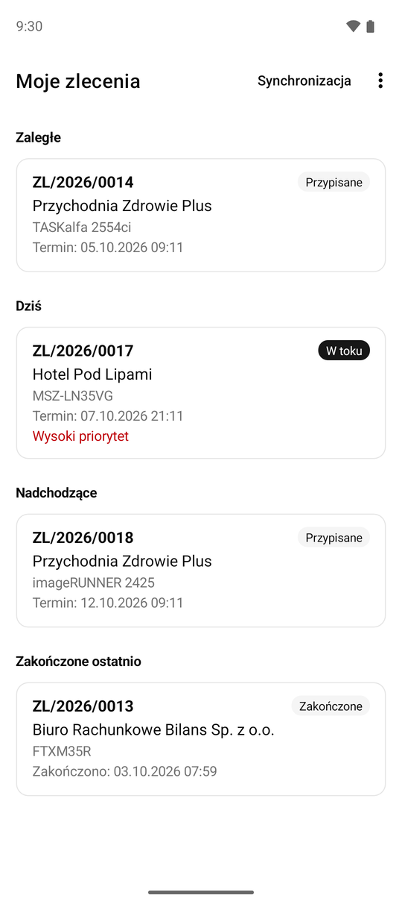
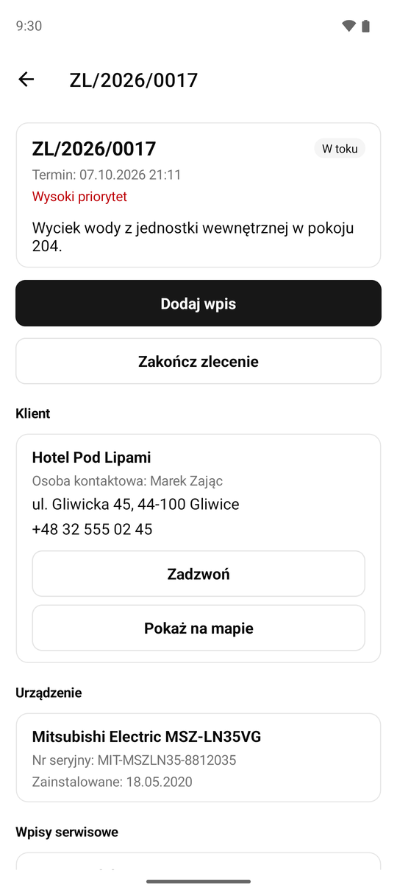
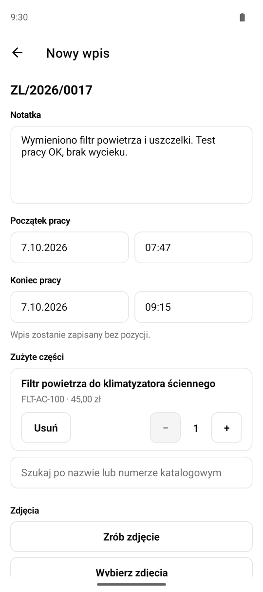
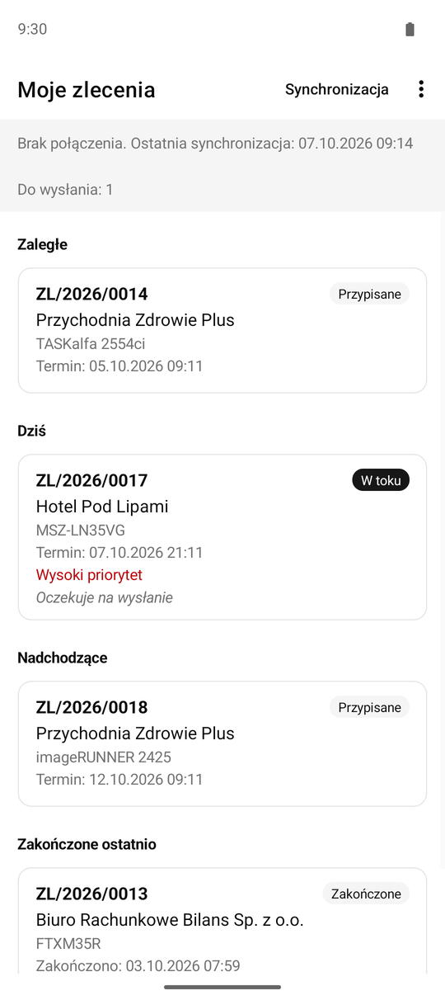
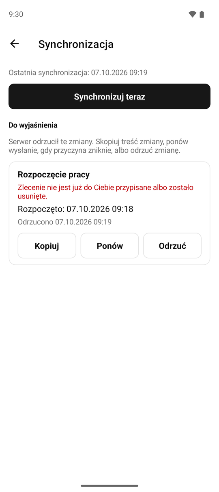
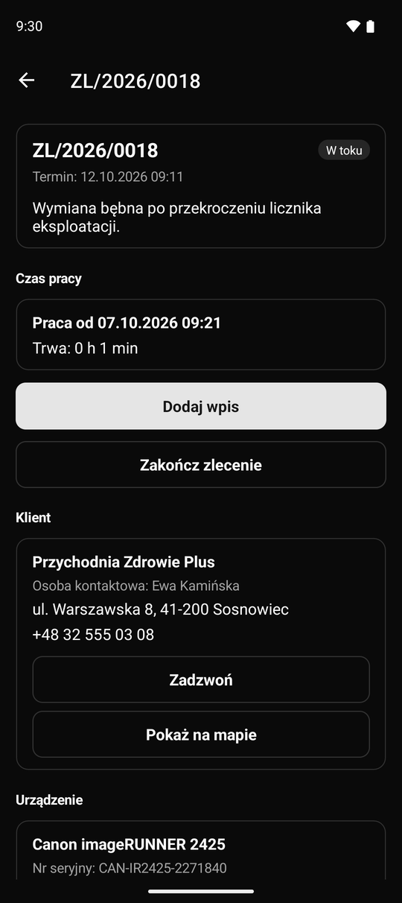
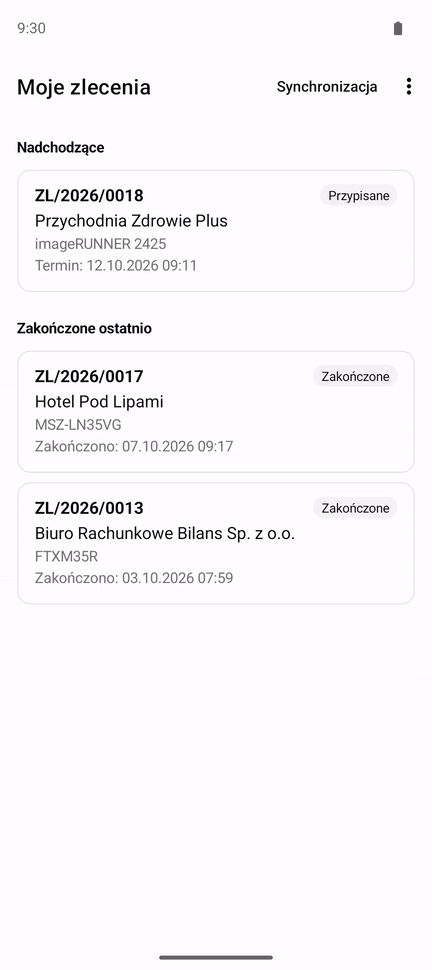
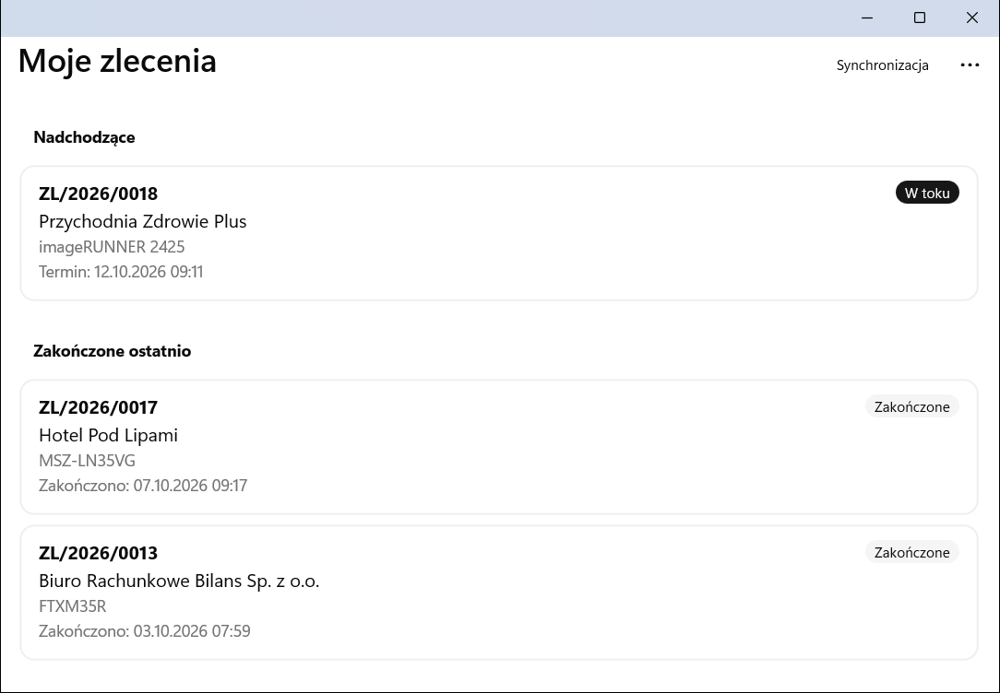
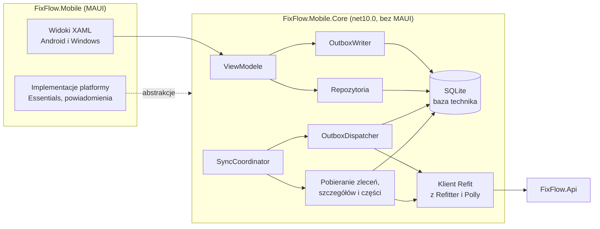

# FixFlow.Mobile

[](https://github.com/mpalus-git/FixFlow.Mobile/actions/workflows/ci.yml)

Aplikacja mobilna technika systemu FixFlow (.NET MAUI 10, Android i Windows). Technik widzi przypisane mu zlecenia, rozpoczyna pracę, dodaje wpisy serwisowe z czasem pracy, zużytymi częściami, zdjęciami i pozycją GPS, a na końcu zamyka zlecenie z podpisem klienta. Wszystko działa także bez zasięgu: zmiany zapisują się lokalnie i trafiają do API po odzyskaniu sieci.

Pozostałe części systemu FixFlow:

- [FixFlow.Api](https://github.com/mpalus-git/FixFlow.Api) - backend .NET 10 z PostgreSQL, źródło reguł biznesowych i kontraktu OpenAPI ([dokumentacja API na żywo](https://fixflow-api-us2p.onrender.com/scalar)).
- [FixFlow.Web](https://github.com/mpalus-git/FixFlow.Web) - panel dyspozytora i administratora (React 19, TypeScript, TanStack Query), działający pod adresem [fix-flow-web.vercel.app](https://fix-flow-web.vercel.app).

## Wypróbowanie

Najnowsze wydanie: [github.com/mpalus-git/FixFlow.Mobile/releases/latest](https://github.com/mpalus-git/FixFlow.Mobile/releases/latest).

| Plik | Platforma | Uruchomienie |
|---|---|---|
| `FixFlow-<wersja>-windows-x64.zip` | Windows 10 1809 lub nowszy, x64 | rozpakować i uruchomić `FixFlow.Mobile.exe`, bez instalacji |
| `FixFlow-<wersja>.apk` | Android 10 lub nowszy | zainstalować spoza sklepu (system poprosi o zgodę na instalację z tego źródła) |

Plik exe nie jest podpisany certyfikatem, więc przy pierwszym uruchomieniu Windows SmartScreen pokaże ostrzeżenie: trzeba wybrać „Więcej informacji”, a potem „Uruchom mimo to”.

Aplikacja łączy się z instancją demo API na Render. Konto technika (Jan Kowalski) ma dane podane w [README FixFlow.Api](https://github.com/mpalus-git/FixFlow.Api#opis-systemu), a w wydaniu można też użyć przycisku „Zaloguj się kontem demo”. Inne role po zalogowaniu dostają link do [panelu dyspozytora](https://fix-flow-web.vercel.app). Warto wiedzieć, że:

- dane demo są wspólne dla wszystkich odwiedzających i wracają do stanu początkowego codziennie o 2:00 UTC;
- serwer działa na darmowym planie, więc po okresie bezczynności startuje do minuty; aplikacja pokazuje wtedy pasek „Serwer się uruchamia” i do tego czasu pracuje na danych lokalnych;
- pracę offline najłatwiej zobaczyć, wyłączając sieć w trakcie pracy i włączając ją z powrotem.

## Zrzuty ekranu

| Moje zlecenia | Szczegóły zlecenia | Wpis serwisowy |
|---|---|---|
|  |  |  |

| Praca offline z kolejką | Zmiana odrzucona przez serwer | Tryb ciemny |
|---|---|---|
|  |  |  |

Praca bez sieci: rozpoczęcie zlecenia i wpis serwisowy czekają w kolejce, a po odzyskaniu połączenia trafiają do API w kolejności, w jakiej powstały.



Wersja Windows:



## Opis systemu

FixFlow to system obsługi zleceń serwisowych w terenie dla firmy naprawiającej klimatyzację i urządzenia biurowe. Składa się z trzech części:

- [FixFlow.Api](https://github.com/mpalus-git/FixFlow.Api) - backend ASP.NET Core z PostgreSQL, źródło prawdy dla reguł biznesowych i kontraktu OpenAPI.
- [FixFlow.Web](https://github.com/mpalus-git/FixFlow.Web) - panel webowy dyspozytora i administratora: zlecenia, przypisywanie techników, klienci, urządzenia i części. Technik ma w nim tylko podgląd swoich zleceń.
- FixFlow.Mobile (to repozytorium) - jedyne miejsce, w którym technik zmienia stan zleceń.

Technik może:

- przeglądać swoje zlecenia w sekcjach zaległe, dziś, nadchodzące i zakończone ostatnio;
- otworzyć szczegóły z klientem i osobą kontaktową, urządzeniem, wpisami serwisowymi, historią zlecenia (utworzenie, przypisanie, zmiana terminu, rozpoczęcie, zakończenie) i swoimi wcześniejszymi zleceniami na tym urządzeniu, zadzwonić do klienta, otworzyć adres w aplikacji map i pobrać protokół PDF zakończonego zlecenia;
- rozpocząć zlecenie przypisane (Przypisane -> W toku), przy czym w toku może mieć najwyżej jedno; aplikacja zapisuje pozycję GPS z chwili rozpoczęcia, jeśli technik się na to zgodzi;
- dodawać wpisy serwisowe z notatką, czasem pracy, częściami z katalogu (wyszukiwanie działa offline) i zdjęciami z aparatu lub z plików;
- poprawić pomyłkę wpisem korygującym, który zwraca części najwyżej do ilości netto zużytej na zleceniu (wpisów nie da się edytować ani usuwać);
- zakończyć zlecenie (W toku -> Zakończone), jeśli ma co najmniej jeden wpis, z opcjonalnym podpisem klienta złożonym palcem lub myszą, który trafia do protokołu PDF;
- dostać przypomnienie godzinę przed terminem zlecenia (Android);
- przełączyć język (polski, angielski) i motyw (systemowy, jasny, ciemny).

Reguły biznesowe egzekwuje API. Aplikacja je odzwierciedla, czyli ukrywa niedozwolone akcje i blokuje lokalnie oczywiste błędy, ale zawsze obsługuje odpowiedź błędu z serwera, także z opóźnieniem, gdy zmiana zrobiona offline zostanie odrzucona przy synchronizacji.

## Stack

| Obszar | Technologie |
|---|---|
| Podstawa | .NET 10, .NET MAUI 10 (Android API 29+, Windows unpackaged i self-contained), C# z Nullable i TreatWarningsAsErrors |
| UI | XAML z kompilowanymi wiązaniami, Shell, CommunityToolkit.Mvvm (source generatory, WeakReferenceMessenger), GraphicsView (pole podpisu) |
| Komunikacja z API | Refit 16 z klientem i kontraktami generowanymi przez Refitter z OpenAPI, Microsoft.Extensions.Http.Resilience (Polly) |
| Dane lokalne | SQLite (sqlite-net-pcl), osobny plik bazy dla każdego technika, własne migracje schematu |
| Funkcje urządzenia | MAUI Essentials (Connectivity, SecureStorage, MediaPicker, Geolocation, Map, Launcher, Clipboard), Plugin.LocalNotification |
| Języki | pliki .resx (polski domyślny, angielski) |
| Testy | xUnit v3, Shouldly, NSubstitute, Microsoft.Extensions.TimeProvider.Testing, Testcontainers |
| Narzędzia | własne narzędzie Roslyn (usuwanie i kontrola komentarzy), Central Package Management, GitHub Actions |

## Uruchomienie lokalne

Wymagane są .NET SDK 10 (wersja w `global.json`) i workloady MAUI w zestawie przypiętym w `global.json`:

```bash
dotnet workload restore src/FixFlow.Mobile/FixFlow.Mobile.csproj
```

Do wersji Android potrzebne są Android SDK z emulatorem (API 29 lub nowsze) i JDK 21, na przykład z instalacji Visual Studio. Wersja Windows buduje się tylko na Windows.

### Z lokalnym API

Wymagany jest Docker. W repozytorium [FixFlow.Api](https://github.com/mpalus-git/FixFlow.Api#uruchomienie-lokalne) całe środowisko startuje przez `docker compose up --build` (z kontami i danymi demo). Build Debug łączy się z nim automatycznie: emulator Androida przez `http://10.0.2.2:8080`, Windows przez `http://localhost:8080`. Ruch HTTP bez TLS jest dozwolony tylko w Debug.

```bash
dotnet build src/FixFlow.Mobile -t:Run -f net10.0-android
dotnet run --project src/FixFlow.Mobile -f net10.0-windows10.0.19041.0
```

### Z API na Render

Adres API jest właściwością MSBuild `FixFlowApiBaseUrl` zamienianą przy buildzie na stałą w kodzie. Build Release używa Render domyślnie, a w Debug wystarczy ją nadpisać:

```bash
dotnet build src/FixFlow.Mobile -t:Run -f net10.0-android -p:FixFlowApiBaseUrl=https://fixflow-api-us2p.onrender.com
```

Przycisk szybkiego logowania kontem demo pojawia się tylko wtedy, gdy przy buildzie podano właściwości `DemoTechnicianEmail` i `DemoTechnicianPassword` (w workflow wydania pochodzą z sekretów repozytorium).

### Skrypty

| Polecenie | Co robi |
|---|---|
| `scripts/sync-api-contract.sh` | pobiera aktualny kontrakt z main repozytorium API do `openapi/fixflow-api.v1.json` |
| `scripts/generate-api-client.sh` | generuje klienta Refit z kontraktu (Refitter) i usuwa z niego komentarze |
| `dotnet test --project tests/FixFlow.Mobile.UnitTests` | testy jednostkowe |
| `dotnet test --project tests/FixFlow.Mobile.IntegrationTests` | testy integracyjne na prawdziwym API (wymagają Dockera) |
| `dotnet run --project tools/FixFlow.Tools -- check-comments .` | kontrola braku komentarzy w repozytorium |

## Architektura



Kod jest podzielony na dwa projekty:

- `src/FixFlow.Mobile.Core` (zwykłe `net10.0`, bez zależności od MAUI): ViewModele, synchronizacja, kolejka operacji, dostęp do SQLite, wygenerowany klient API, zasoby językowe i abstrakcje platformy (`INavigationService`, `IConnectivityService`, `ISecureStore`, `ILocationService` i inne). Dzięki temu cała logika jest testowana zwykłymi testami jednostkowymi, bez emulatora.
- `src/FixFlow.Mobile`: widoki XAML, implementacje abstrakcji na MAUI Essentials, `MauiProgram` z rejestracją w DI i kod platformowy w `Platforms/`.

W obu projektach kod jest podzielony według funkcji: `Features/Auth`, `WorkOrders`, `ServiceEntries`, `Parts`, `Sync`, `Settings`. Większe obszary mają podfoldery: `Sync/Outbox` (zapis i wysyłka kolejki), `Sync/Pull` (pobieranie z API), `Sync/Conflicts` (zmiany do wyjaśnienia) oraz `WorkOrders/List`, `WorkOrders/Details` i `WorkOrders/WorkTime` (licznik czasu pracy). Przypomnienia są w `Notifications`, a wspólne elementy ekranów (stany, pasek stanu) w `Screens`. Para widok i ViewModel to np. `WorkOrderListPage.xaml` w aplikacji i `WorkOrderListViewModel` w Core. Nawigacja idzie wyłącznie przez `INavigationService` z parametrem odbieranym przez interfejs `INavigatedTo<T>`, więc ViewModele nie znają Shell.

## Decyzje techniczne

### Offline-first i kolejka operacji

Ekrany czytają najpierw dane z lokalnej bazy, a odświeżenie z API idzie w tle. Każda zmiana (rozpoczęcie, wpis serwisowy, zdjęcie, wpis korygujący, zakończenie) zapisuje się w tabeli `outbox_operations` w jednej transakcji SQLite z danymi lokalnymi, np. z licznikiem czasu pracy. ViewModele nigdy nie wołają API przy operacjach zmieniających stan.

Dane pobrane z serwera nie są modyfikowane przez lokalne zmiany. Operacje czekające w kolejce są nakładane na wynik przy odczycie (status, wpis ze znacznikiem „Oczekuje na wysłanie”, dostępna ilość części), więc pobranie z API może zawsze nadpisać lokalną kopię (serwer wygrywa), a zmiany technika nie znikają z ekranu.

`OutboxDispatcher` wysyła operacje ściśle w kolejności powstania w obrębie zlecenia; zlecenia są od siebie niezależne. Synchronizacja (`SyncCoordinator`, jedna naraz i najwyżej jeden przebieg w kolejce) rusza przy starcie i powrocie aplikacji na pierwszy plan, po odzyskaniu sieci, po każdej lokalnej zmianie i przy pull-to-refresh. Po każdym przebiegu koordynator ustawia jeden timer na najbliższy termin ponowienia operacji odrzuconej przejściowo, więc kolejka wychodzi sama także bez nowego wyzwalacza; timer jest wstrzymywany, gdy aplikacja schodzi w tło.

Ruch sieciowy jest ograniczony: powrót na listę pobiera zlecenia ponownie dopiero wtedy, gdy ostatnie pobranie ma co najmniej 5 minut, a katalog części jest pobierany przy pull-to-refresh, po wysłaniu wpisu, który zmienił stan części, albo gdy jego kopia ma co najmniej 15 minut.

### Idempotencja

Wpis serwisowy zużywa części, więc dwukrotne wysłanie tego samego wpisu byłoby błędem danych. Identyfikator wpisu i zdjęcia nadaje aplikacja (`Guid.CreateVersion7()`) w chwili zapisu offline, a API przy ponownym wysłaniu tego samego id zwraca 200 bez ponownego zdjęcia części ze stanu. Ponowione rozpoczęcie i zakończenie zlecenia, które ma już docelowy status, API również przyjmuje odpowiedzią 200 z bieżącym stanem, więc 409 zawsze oznacza prawdziwy konflikt. Rozpoczęcie i zakończenie niosą czas z urządzenia z chwili zapisu offline, dzięki czemu historia zlecenia pokazuje, kiedy technik faktycznie zaczął i skończył pracę, a nie kiedy wróciła sieć. Te zmiany w API powstały na potrzeby tej aplikacji, a scenariusze „odpowiedź zgubiona, operacja wysłana ponownie” są pokryte testami integracyjnymi.

### Błędy: ponowienie czy konflikt

Odpowiedzi błędów są mapowane z ProblemDetails (`errorCode`, błędy pól, `Retry-After`) i klasyfikowane:

| Odpowiedź | Co się dzieje |
|---|---|
| brak sieci, timeout, 408, 429, 5xx | operacja zostaje w kolejce i jest ponawiana z backoffem 5 s, 15 s, 1 min, 5 min, 15 min z losowym rozrzutem 20%; `Retry-After` ma pierwszeństwo |
| 401 | wysyłka się zatrzymuje, kolejka zostaje bez zmian do ponownego zalogowania |
| inne 4xx, w tym 404 po odebraniu zlecenia, 409 i brak części na stanie | operacja trafia do „Do wyjaśnienia”, a dalsze zmiany tego zlecenia czekają na decyzję technika |

Nic nie znika po cichu i nic nie jest ślepo nadpisywane. Ekran synchronizacji pokazuje przyczynę przetłumaczoną po `errorCode` (gdy tłumaczenia brak, `detail` z ProblemDetails) i treść lokalnej zmiany do skopiowania. Technik może ponowić zmianę, gdy przyczyna zniknie (np. po dostawie części), odrzucić ją albo odrzucić wszystkie zmiany zlecenia. Odrzucenie sprząta też dane zależne: licznik czasu, pliki zdjęć.

### Sesja i odświeżanie tokenów single-flight

Access token jest tylko w pamięci, refresh token w SecureStorage. API rotuje refresh token przy każdym odświeżeniu, a ponowne użycie starego unieważnia całą rodzinę tokenów. Dlatego `TokenRefresher` odświeża pod `SemaphoreSlim`: równoległe żądania, które dostały 401, czekają na jedno odświeżenie, a wewnątrz blokady sprawdzane jest, czy inne żądanie już nie wymieniło tokena. `AuthenticationHandler` powtarza żądanie najwyżej raz. Po 429 (limit 10 logowań i odświeżeń na minutę) nowa próba czeka do czasu z `Retry-After`.

Wygaśnięcie sesji przenosi do logowania, ale lokalne dane i kolejka zostają: po ponownym zalogowaniu tego samego technika synchronizacja rusza dalej. Każdy technik ma osobny plik bazy, więc zmiany jednej osoby nigdy nie zostaną wysłane na konto innej. Start bez sieci z zapisaną sesją otwiera dane lokalne bez wymuszania logowania. Świadome wylogowanie wymaga potwierdzenia z liczbą niewysłanych zmian i usuwa dane technika z urządzenia.

### Uśpiony serwer

Instancja na Render po okresie bezczynności trzyma pierwsze żądanie bez odpowiedzi do startu, nawet około minuty. Przed pierwszą synchronizacją aplikacja wywołuje `/api/v1/system/ready`; gdy odpowiedź nie przyjdzie w 3 s, pokazuje pasek „Serwer się uruchamia” i ponawia co 3 s do 90 s, a technik w tym czasie pracuje na danych lokalnych. Zwykłe żądania mają timeout 10 s na próbę i 30 s łącznie, a ponawianie przez Polly dotyczy tylko metod bezpiecznych; operacje zmieniające stan ponawia kolejka.

### Kontrakt API i generowany klient

Kopia kontraktu jest w `openapi/fixflow-api.v1.json`. Refitter generuje z niej interfejs Refit i rekordy żądań i odpowiedzi, więc w repozytorium nie ma ręcznie pisanych DTO. CI generuje klienta ponownie i odrzuca build, jeśli różni się od commitowanego, a osobny, nieblokujący job ostrzega, gdy kopia kontraktu rozjechała się z main repozytorium API.

### Zdjęcia

API przyjmuje zdjęcia jako surowy JPEG pod identyfikatorem nadanym przez klienta (`PUT /api/v1/photos/{id}`, do 1 MiB), a wpis zawiera ich adresy. Dzięki temu adres zdjęcia jest znany offline, a wysłanie zdjęcia jest osobną operacją w kolejce, która musi się udać przed wysłaniem wpisu. Zdjęcia są skalowane do 1600 px na dłuższym boku z jakością JPEG 75, trzymane w katalogu danych aplikacji i usuwane po wysłaniu.

### Podpis klienta

Podpis jest zdjęciem wysyłanym w kolejce przed zakończeniem zlecenia, więc działa offline tak samo jak zdjęcia wpisów, a API wstawia go do protokołu PDF. Pole podpisu to `GraphicsView` z własnym `IDrawable`, bez zewnętrznej biblioteki: wspólny kod rysuje kreski na białym tle, a eksport do JPEG jest osobny dla platform (na Androidzie `PlatformBitmapExportService`, na Windows Win2D), bo eksport MAUI na Windows nie jest zaimplementowany. Wyjście z ekranu zakończenia z narysowanym podpisem, a także z niezapisanego wpisu lub korekty, wymaga potwierdzenia, niezależnie od tego, czy technik użyje systemowego przycisku Wstecz, strzałki paska czy przycisku wstecz na Windows.

### Wygląd

Paleta, znak aplikacji oraz plakietki statusu i priorytetu odpowiadają panelowi dyspozytora (kolory przeliczone z tokenów panelu), w trybie jasnym i ciemnym. Stan połączenia, komunikaty oraz liczby zmian do wysłania i do wyjaśnienia są zebrane w jednym pasku nad treścią, którego kolor zależy od najpoważniejszego stanu, a z listy prowadzi on do ekranu synchronizacji. W wersji Windows treść ma ograniczoną szerokość, żeby na dużym oknie nie rozciągała się na cały ekran.

### Strefa czasowa i formaty

Daty są pokazywane w strefie Europe/Warsaw niezależnie od strefy urządzenia, a sekcje listy (dziś, zaległe) liczone są według dnia w Warszawie. Czas pochodzi z wstrzykiwanego `TimeProvider`, więc testy sprawdzają granicę dnia oraz czas letni i zimowy przy urządzeniu ustawionym na inną strefę. Formaty dat są zapisane jawnie dla każdego języka, bo wzorce domyślne zależą od wersji ICU na urządzeniu.

### Dostępność

Elementy interaktywne mają opisy dla TalkBack i Narratora. Czytnik ekranu ogłasza błędy logowania i walidacji formularzy, nowe komunikaty na pasku stanu, utratę i powrót sieci oraz wynik ręcznej synchronizacji. Układ jest sprawdzony przy czcionce systemowej 130% i 200% na ekranie 360 dp: plakietka statusu przechodzi pod numer zlecenia, przyciski się zawijają, a pole podpisu zachowuje minimalną wysokość. Dwie poprawki wynikają z zachowania MAUI: na Androidzie opis (`SemanticProperties.Description`) pola tekstowego trafia do drzewa dostępności razem z surową treścią pola, więc pole hasła dostaje etykietę przez `Hint`, żeby hasło nie wyciekło do usług dostępności. Na Windows elementy `CollectionView` miały w UI Automation nazwę typu MAUI zamiast treści, więc karty listy i nagłówki sekcji dostają nazwy z widocznych tekstów.

### Pozostałe

- Bez kontrolki mapy: kontrolka MAUI na Androidzie wymaga klucza Google Maps z kontem rozliczeniowym, a technikowi wystarcza otwarcie adresu i pozycji GPS w zewnętrznej aplikacji map (`Map.OpenAsync`).
- Uprawnienia (aparat, lokalizacja, powiadomienia na Android 13+) są proszone dopiero przy pierwszym użyciu funkcji, z wyjaśnieniem i linkiem do ustawień po odmowie. Brak zgody na lokalizację nie blokuje pracy, wpis idzie bez pozycji.
- Przypomnienia o terminie są planowane i anulowane przy każdej synchronizacji (zmiana terminu, odebranie zlecenia, zakończenie), jako powiadomienia nieprecyzyjne, bez uprawnienia do dokładnych alarmów.
- Teksty widoczne dla użytkownika pochodzą wyłącznie z plików .resx. Język domyślny to polski, niezależnie od języka urządzenia.
- Repozytorium nie zawiera komentarzy w kodzie, XAML, plikach projektu ani YAML. Pilnuje tego własne narzędzie na Roslyn uruchamiane w CI, a z wygenerowanego klienta komentarze są usuwane.

## Testy

| Projekt | Liczba | Zakres |
|---|---|---|
| `FixFlow.Mobile.UnitTests` | 481 | ViewModele (komendy, stany, walidacja, widoczność akcji, ochrona niezapisanych formularzy, ogłaszanie komunikatów), pasek stanu, kolejka operacji (kolejność, ponawianie, timer ponowień, klasyfikacja błędów, konflikty), nakładanie zmian oczekujących, historia zlecenia, sesja i równoległe odświeżanie tokena, mapowanie ProblemDetails, migracje i repozytoria SQLite, sprzątanie zdjęć, daty w Europe/Warsaw, planowanie przypomnień |
| `FixFlow.Mobile.IntegrationTests` | 14 | synchronizacja na prawdziwym API |
| `FixFlow.Tools.Tests` | 40 | usuwanie i wykrywanie komentarzy |

Testy jednostkowe używają SQLite na prawdziwym pliku w katalogu tymczasowym (bez mockowania bazy), własnego `HttpMessageHandler` zamiast HttpClient i NSubstitute tylko dla abstrakcji platformy.

Testy integracyjne uruchamiają przez Testcontainers PostgreSQL 18 i obraz `ghcr.io/mpalus-git/fixflow.api` przypięty do konkretnego commita, a dane każdego testu zakłada konto administratora. Sprawdzają m.in. pełny przebieg technika (logowanie, rozpoczęcie, wpis z częścią, zakończenie), wysłanie zdjęcia przed wpisem, zakończenie z podpisem klienta, wpis korygujący zwracający części, odrzucenie rozpoczęcia po przekazaniu zlecenia innemu technikowi, ponowienie wpisu odrzuconego z braku części po dostawie, brak duplikatu wpisu, rozpoczęcia i zakończenia wysłanych ponownie po zgubionej odpowiedzi oraz zachowanie kolejki przy zatrzymanym kontenerze API.

CI uruchamia osobno: build i testy jednostkowe, testy integracyjne, kontrolę komentarzy, kontrolę wygenerowanego klienta, porównanie kontraktu z API (ostrzeżenie), build Androida i build Windows. Pokrycie linii `FixFlow.Mobile.Core` z testów jednostkowych i integracyjnych razem trafia do podsumowania przebiegu, z podziałem na obszary, bez progów. Wydanie na tag `v*` buduje podpisany APK i archiwum zip wersji Windows.

Wydajność zmierzona na podpisanym APK wydania na emulatorze Pixel 9 (Android 16): zimny start do pierwszej klatki (`am start -W`, mediana z 11 prób) 1,1 s zarówno do ekranu logowania, jak i do listy z zapisaną sesją. Przy przewijaniu (`dumpsys gfxinfo`) 3,4% klatek listy i 1,8% klatek szczegółów przekracza budżet klatki, mediana czasu klatki to 17 ms. Wyniki nie wymagały optymalizacji.

## Ograniczenia

- Brak synchronizacji w tle: kolejka jest wysyłana tylko wtedy, gdy aplikacja działa. Zmiany zrobione offline czekają do jej otwarcia po odzyskaniu sieci, a przypomnienia o zmianie terminu w panelu docierają po najbliższej synchronizacji.
- Brak wersji iOS i Mac Catalyst.
- Brak automatycznych testów UI. Ekrany są sprawdzane ręcznie na emulatorze Androida i w wersji Windows, w obu motywach i na małym ekranie. Dostępność jest sprawdzana na drzewie dostępności Androida i drzewie UI Automation, bez ręcznego testu z włączonym TalkBack i Narratorem.
- Przypomnienia działają tylko na Androidzie: wersja Plugin.LocalNotification dla Windows wymaga nowszego Windows App SDK niż MAUI 10.
- Pozycja GPS trafia tylko do pierwszego wpisu po rozpoczęciu zlecenia, bo w API jest polem wpisu, a nie rozpoczęcia.
- Protokół PDF można pobrać tylko online.
- Konto demo technika jest wspólne: zlecenia rozpoczęte lub zakończone przez innych odwiedzających są widoczne do nocnego resetu, a limit 10 logowań i odświeżeń sesji na minutę liczy się dla adresu IP.

## Co zrobiłbym inaczej

- Synchronizacja w tle (WorkManager na Androidzie), żeby kolejka wychodziła bez otwierania aplikacji.
- Powiadomienia push z serwera o nowym przypisaniu i odebraniu zlecenia zamiast polegania na synchronizacji przy otwarciu.
- Rozwiązywanie konfliktu przez edycję zmiany (np. zmniejszenie ilości części i ponowienie) zamiast tylko kopiowania, ponowienia albo odrzucenia.
- Testy UI kluczowej ścieżki offline (Appium) na emulatorze w CI.

## Licencja

Wszelkie prawa zastrzeżone. Kod jest udostępniony wyłącznie do wglądu; wykorzystanie, kopiowanie lub modyfikacja wymagają zgody autora.
